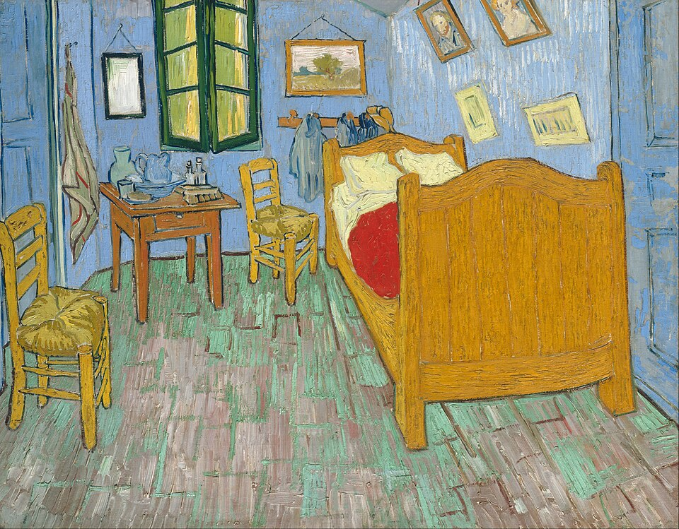
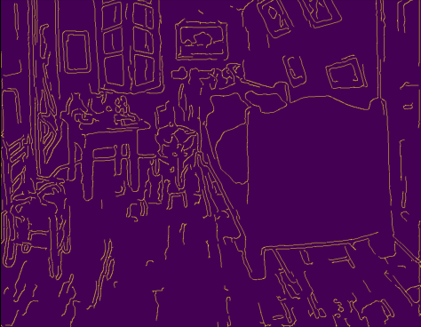
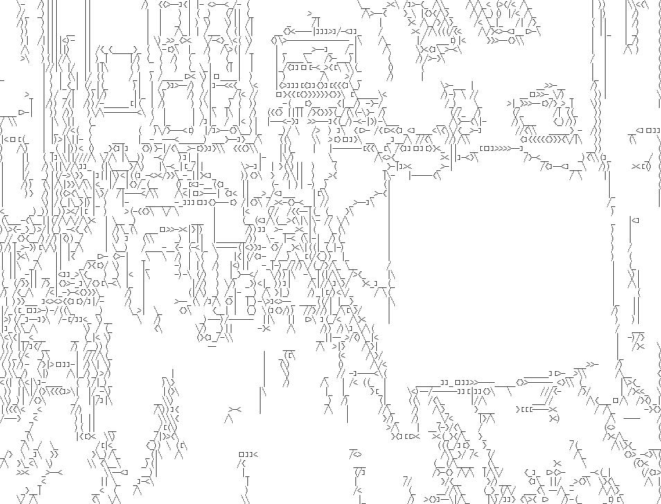

# ASCII Edge Detector

This command line application turns your images into beautiful ascii or unicode illustrations.





## Requirements and installation

Python 3.10 or later is required. Install the project in an isolated environment;
the project configuration installs all required Python dependencies and creates
the `askit` command.

### macOS and Linux

```sh
python3 -m venv .venv
source .venv/bin/activate
python -m pip install --upgrade pip
python -m pip install -e .
```

### Windows PowerShell

```powershell
py -m venv .venv
.\.venv\Scripts\Activate.ps1
python -m pip install --upgrade pip
python -m pip install -e .
```

Run `askit --help` to see all options. You can also run the script
directly with `python main.py`.

## Basic usage

```sh
askit examples/images/girl_with_a_pearl_earring.jpg
askit image.jpg --destination output.txt
askit image.jpg --destination output.rtf
askit image.jpg --destination output.png
```

The default destination is `console`. Supported output extensions are `.txt`,
`.rtf`, `.png`, `.jpg`, `.jpeg`, `.tif`, and `.tiff`. The output format is
selected from the destination extension.
After saving to a file, `askit` opens it with the operating system's default
application.

## Options

| Option | Description |
| --- | --- |
| `-m`, `--method` | Edge detector: `canny` (default) or `threshold`. |
| `-k`, `--kernel` | Derivative kernel preset: `elementary` (default), `prewitt`, `scharr`, `sobel`, or `custom`. |
| `-t1`, `--primary-threshold` | Primary edge threshold. |
| `-t2`, `--secondary-threshold` | Secondary threshold for Canny. |
| `-g SIZE SIGMA`, `--gaussian SIZE SIGMA` | Gaussian blur size and sigma for Canny. |
| `-f`, `--font` | Optional path to a font file. If omitted, an installed monospace font is selected. |
| `-fs`, `--font-size` | Font size in pixels. |
| `-c`, `--chars` | A built-in charset name or a custom string of characters. |
| `-fc`, `--font-color` | Text color for image output, as a Pillow-compatible color (default `#000000FF`). |
| `-bc`, `--background-color` | Background color for image output (default `#FFFFFFFF`). |
| `-np`, `--no-preview` | Skip the edge-image preview window. |
| `--no-open` | Save output files without opening them in the default application. |

Built-in charsets are `minimal`, `basic` (the default), `extended`, and
`borderbox`. For example:

```sh
askit image.jpg --chars borderbox
askit image.jpg --chars '@#.'
```

Custom charsets must contain at least one character and cannot repeat
characters. Quote custom strings in the shell when they contain spaces or
characters interpreted by the shell.

The automatically selected or explicitly supplied font must be monospace.
Non-monospace fonts and unreadable font files are rejected.

## Custom derivative kernels

Select `--kernel custom` and provide both derivative matrices as JSON. Each
matrix must be a non-empty rectangular array of finite numbers.

```sh
askit image.jpg --kernel custom \
  --kernel-x '[[-1, 0, 1], [-2, 0, 2], [-1, 0, 1]]' \
  --kernel-y '[[-1, -2, -1], [0, 0, 0], [1, 2, 1]]'
```

## Troubleshooting

Command-line usage problems and expected image, font, and output errors are
reported as concise command-line messages. Check that the input image exists,
that a specified font path is readable and monospace, and that the destination
extension is supported.
The tool struggles to handle images with larger resolution and therefore may take longer than expected. Try to use larger font sizes and stronger gaussian filters in that case or use a lower resolution image.
